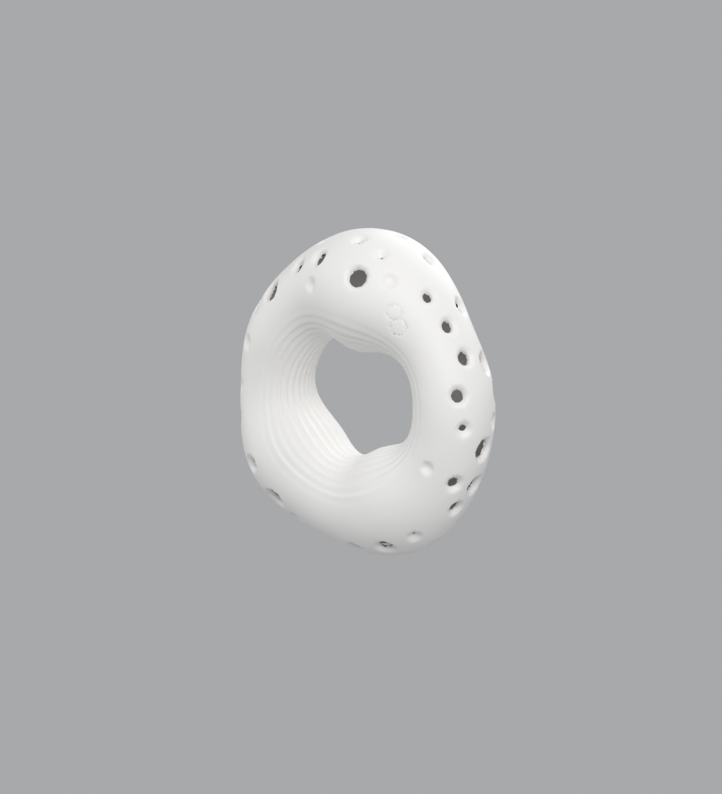

# blender_stroika

Процедурный коралл в Blender **без GUI**: базовая сетка и дерево Geometry Nodes
строятся целиком из Python. Форма (v12) — закрученное кольцо-«мёбиус»:
труба переменного сечения, свитая по окружности, сечение доворачивается на
1.5 полуоборота, внутри — спиральные рёбра-складки, снаружи — крупные
губчатые поры. Референсы: `reference/Qwen21_00015.png`, `Qwen21_00020.png`.



## Состав

| Путь | Что это |
| --- | --- |
| `scripts/coral_gn.py` | генератор: тело вращения (61.7k вершин) + модификатор CoralGN (228 нод) |
| `reference/Qwen21_00002.png` | целевая морфология |
| `renders/coral_final.png` | финальный рендер (Cycles 1000×1100, 72 spp) |
| `renders/draft_v10_d.png → draft_v10_h.png` | прогресс итераций |
| `renders/draft_v10_54.png` | контрольный рендер на Blender 5.4.0 Alpha |
| `coral.blend` | готовая сцена (слайдеры в модификаторе CoralGN) |
| `worklog.md` | журнал работ Task 1–5 |

## Запуск

```bash
blender -b --factory-startup -P scripts/coral_gn.py            # просто собрать
CORAL_LOW=1  CORAL_OUT=draft.png  blender -b --factory-startup -P scripts/coral_gn.py   # черновик ~10 c
CORAL_BLEND=coral.blend CORAL_OUT=final.png blender -b --factory-startup -P scripts/coral_gn.py  # финал + blend
```

Переменные: `CORAL_LOW` (черновое качество), `CORAL_OUT` (png), `CORAL_BLEND`
(сохранение сцены), `CORAL_DIAG` (bbox/счётчики), `CORAL_STAGE` (бисект цепочки:
`twist|wobble|pleats|lobes|holes|blur|bool`).

## Слайдеры модификатора CoralGN

| Слайдер | Дефолт | За что отвечает |
| --- | --- | --- |
| `Wobble` | 0.012 | лёгкая органическая неровность |
| `Pores Enable` | 1.0 | вкл/выкл губчатые поры |
| `Pore Spacing` | 0.112 | шаг пор (≥ 2·радиуса — без перекрытий!) |
| `Pore Radius` | 0.040 | средний радиус пор основания |
| `Pore Var` | 0.55 | разброс радиуса (мелкие — глухие, крупные — сквозные) |
| `Fine Spacing` | 0.074 | шаг мелких пор на веерах |
| `Fine Radius` | 0.028 | радиус мелких пор на веерах |
| `Smooth` | 4 | итерации финального сглаживания |
| `Cutter Scale` | 1.0 | масштаб объекта-резака |
| `Cutter Object` | — | объект для Mesh Boolean (Difference) |
| `Extra Object` | — | своя геометрия, деформируется вместе с кораллом |

Любой слайдер можно задать через env: `GN_FAN_SPREAD=0.8 GN_PORE_RADIUS=0.035 ...`.

Прочие env: `CORAL_WALL=0.024` — толщина стенки (= глубина пор, заложена в базовый
солид); `CORAL_SOLVER=FLOAT` — солвер Mesh Boolean (EXACT в 5.3 падает segfault'ом;
FLOAT требует неперекрывающихся сфер-резаков, иначе кольца-шрамы).

## Как устроены поры (v11)

База — замкнутый солид (внешняя + внутренняя поверхность, сдвиг профиля на
`CORAL_WALL`). По наружной поверхности Poisson-точки (DPF, маска зоны × фильтр
нормали), на каждой — своя сфера (Random × Radius), Realize → **Mesh Boolean
Difference**. Настоящие сквозные/глухие дырки с чистой круглой кромкой, как у губки.

## Проверено на версиях

- Blender **5.3.0 Beta** (`f75ffda59776`) — основная.
- Blender **5.4.0 Alpha** (`6f4fc760c138`) — цепочка деформаций v10 совпадала с 5.3
  побайтово; v11 использует те же ноды. Версия вторична — решает параметризация.

## Sweep-параметры формы (v12, env)

| env | Дефолт | Что делает |
| --- | --- | --- |
| `CORAL_TWIST` | 1.5 | полуобороты сечения по кольцу (мёбиус-скрутка) |
| `CORAL_RING_R` | 0.43 | радиус кольца |
| `CORAL_PLEAT_COUNT` | 36 | число рёбер в сечении (чётное) |
| `CORAL_PLEAT_DEPTH` | 0.024 | глубина рёбер (только внутренняя сторона) |
| `CORAL_WALL` | 0.028 | толщина стенки = глубина пор |
